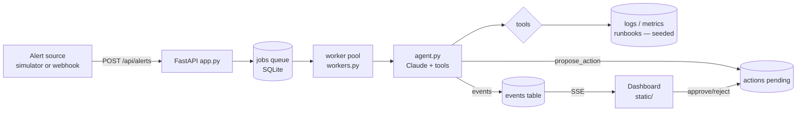

# SignalOps — AI incident-response workspace

A live incident dashboard where an AI agent investigates alerts and a human
stays in control. Incidents arrive via webhook or the built-in simulator,
a worker pool runs the investigation agent, and every step streams to the
dashboard in real time. The agent proposes actions; humans approve them.

## What it demonstrates (system design topics)

| Topic | Where it lives |
| ----- | -------------- |
| Job queue + worker pool | `jobs.py` (SQLite `BEGIN IMMEDIATE` claim) + `workers.py` (async pool) |
| Retries + dead-letter | `queue.fail()` — exponential backoff, `dead` after 3 attempts |
| Real-time streaming | `broker.py` pub/sub + SSE at `/api/incidents/{id}/stream` |
| Human-in-the-loop | `actions` table + `/api/actions/{id}/decide` |
| Idempotent enqueue | `POST /api/alerts` → incident + job, safe to retry |
| Durable event log | `events` table — replay history, then live tail |
| External ingestion | `/api/alerts` — Grafana/PagerDuty-style webhook |
| Observability | `/api/stats` — queue depth + counts |

## Architecture



## The demo loop (no real infrastructure needed)

`seed.py` plants three realistic failure scenarios — logs, metrics, and
runbooks — as if they'd come from a real monitoring stack. Click
**Simulate incident**, and the agent investigates the seeded data exactly as
it would real data.

Scenarios: `db_timeout` (checkout DB pool exhaustion), `memory_leak`
(climbing heap on user-svc), `deploy_regression` (post-deploy latency).

## Setup — what to change after cloning

```bash
git clone https://github.com/AbdulhameedSk/SignalOps
cd SignalOps
pip install -r requirements.txt
```

Create `.env` (git-ignored):

```
ANTHROPIC_API_KEY=sk-ant-...     # required
MAX_WORKERS=3                    # optional
MODEL=claude-sonnet-4-5          # optional
```

## How to run

```bash
uvicorn app:app --port 8000
```

Open http://localhost:8000 → **+ Simulate incident** → watch the feed.

Send a dummy alert yourself (this is the real-world path):

```bash
curl -X POST http://localhost:8000/api/alerts \
  -H "Content-Type: application/json" \
  -d "{\"title\":\"payments down\",\"service\":\"checkout-api\",\"severity\":\"critical\"}"
```

Tests (offline): `pytest tests/`

## Connecting real systems

- **Grafana**: alert rule → Contact point (webhook) → POST
  `{title, service, severity, description}` to `/api/alerts`.
- **PagerDuty**: outbound webhook → same payload shape.
- **Real logs/metrics**: replace `db.recent_logs`/`metric_series` calls in
  `tools.py` with calls to Datadog/CloudWatch/Loki — tool signatures stay.

## Deploy

Single Docker service (frontend + API + workers + SQLite in one):

```dockerfile
# Dockerfile included — deploy to Render/Railway/Fly
docker build -t signalops .
docker run -p 8000:8000 -e ANTHROPIC_API_KEY=sk-ant-... signalops
```

**Render:** New Web Service → connect repo → build `pip install -r requirements.txt` → start `uvicorn app:app --host 0.0.0.0 --port $PORT` → add env vars.

Caveats: SQLite resets on redeploy without a volume; the in-process broker
only works single-replica. Both upgrade paths are noted in `docs/`.
